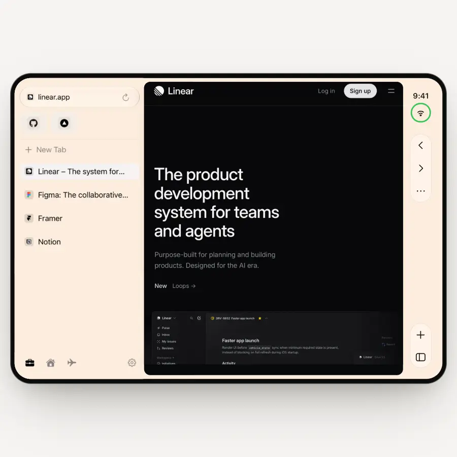
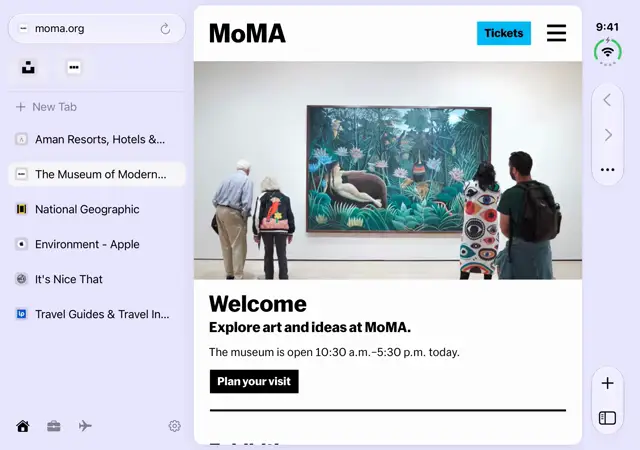
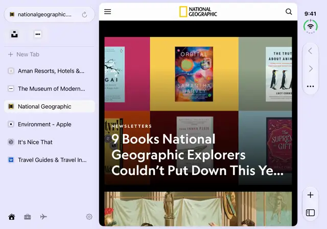
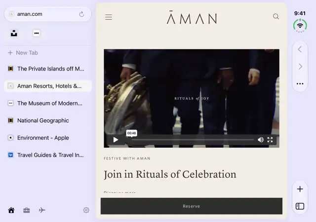
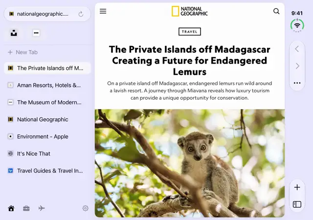

# Browsa

<p align="center">
  <picture>
    <source media="(prefers-color-scheme: dark)" srcset="docs/media/layouts-dark.webp">
    
  </picture>
</p>

A native WebKit browser for iPhone Duo, iPhone and iPad, open source under the [MIT license](LICENSE). Use it as it
is, or fork it as a starting point for your own browser. See it at [browsa.app](https://browsa.app). It brings Arc's navigation model to iOS:

- **Unfolded (inner display):** a collapsible sidebar with spaces, pinned tabs and today tabs. The
  sidebar toggle and a one-tap **New Tab** sit in the Duo's system vertical bar.
- **Folded (outer display):** a phone layout with an address pill and an Arc-style **plus** button
  at the bottom. Swipe the pill sideways to switch tabs, or up to see all tabs.
- **iPhone:** one bottom bar with back, the address capsule, tabs and plus. **iPad** and the Duo's
  inner portrait use a bottom bar too, with a sidebar on the big screen.
- **Recent tabs:** press and hold the tabs button, or the sidebar button where the sidebar is the
  tab list, to jump back to the tabs you were just on. Swipe from the edge to go back and forward.
- **New-tab sheet:** the keyboard is up right away and favourites appear above it. You get
  suggestions from the first keystroke (favourites, open tabs, history ranked by frecency, a
  bundled list of popular sites and search-engine suggestions), plus inline autocomplete like Safari's.
- **Private browsing:** a Private space that appears with your first private tab (hold any plus
  button) and goes away, with its cookies and storage, when the last one closes.
- **Saved:** Save in a page's ⋯ menu keeps it in a flat, newest-first list (⋯ > Saved).
- **Reader:** a distraction-free view of the page, in a sheet or full screen, using Readability.js.
- **Video:** fullscreen hands the video to the system player, with picture-in-picture and AirPlay.
- **Content blocking:** blocks ads and trackers, declines cookie banners and strips tracking
  parameters from links. Each can be turned off in Settings, and blockers can be turned off per site.

## In motion

<table>
  <tr>
    <td></td>
    <td></td>
  </tr>
  <tr>
    <td align="center">Sidebar</td>
    <td align="center">Spaces</td>
  </tr>
  <tr>
    <td></td>
    <td></td>
  </tr>
  <tr>
    <td align="center">Suggestions</td>
    <td align="center">Reader</td>
  </tr>
  <tr>
    <td align="center"></td>
    <td align="center"></td>
  </tr>
  <tr>
    <td align="center">All tabs, closed</td>
    <td align="center">Downloads in the gutter</td>
  </tr>
</table>

## Build

```sh
brew install xcodegen
xcodegen            # generates Browsa.xcodeproj from project.yml
open Browsa.xcodeproj
```

You need Xcode 27.2 or later and the iOS 27.2 SDK. The app runs on iOS 27.1 or later, on an iPhone
Duo, other iPhones and iPad, or their simulators.

To build your own copy, change `DEVELOPMENT_TEAM` and `bundleIdPrefix` in `project.yml`, and the
target bundle identifiers below them, then run `xcodegen` again. The `.xcodeproj` is generated and
git-ignored, so `project.yml` is the file to edit.

Run the suggestion engine's tests without the app:

```sh
cd Packages/BrowserKit && swift test
```

## Layout

```
App/Sources/
  BrowsaApp.swift          entry point, keyboard shortcuts, scene lifecycle
  Posture/PostureAdapter   picks the layout, and every iPhone Duo API call (vertical bar) lives here
  Shell/                   RootView, UnfoldedLayout + SidebarView, FoldedLayout + BottomBar, tab switcher
  NewTab/                  NewTabSheet, AddressField (inline autocomplete), NewTabModel
Packages/BrowserKit/
  Sources/Suggest/         pure Swift: providers, ranking, frecency, inline completion, seed list
  Sources/BrowserCore/     WKWebView sessions + pool, tabs/spaces model, history store, persistence,
                           content blocking, Reader
  Sources/BrowserEngine/   the engine-neutral page API the Mac app uses (see docs/engines.md)
  Sources/WebKitEngine/    WKWebView behind BrowserEngine (macOS)
  Tests/                   Swift Testing suites for BrowserCore and the suggest engine
Mac/Sources/               Browsa for Mac: State/ (spaces, tabs, pages), Views/ (sidebar, command bar)
App/UITests/               UI tests that drive the real app on a simulator
tools/build_seed.py        rebuilds the seed list from Chrome UX Report top lists (see below)
tools/seed_curated.json    brand names, typed aliases (yt, gh, gmail), allow and deny lists
tools/filter-rules/        builds and publishes the content-blocking rules (GPL 3.0, see License)
website/                   the browsa.app site and privacy policy (see website/README.md)
```

## How it fits together

- **Posture follows the size class.** Compact width gets the folded layout and regular width gets
  the unfolded one. The hinge isn't involved, so the layout can't disagree with the display.
- **The web view outlives the layouts.** `BrowserState` is the single source of truth, and each tab
  has one `WKWebView` that `WebViewHost` re-parents when the layout changes, so folding never
  reloads a page. `WebViewPool` keeps a limited number of them alive and freezes the rest.
- **Debugging.** In Console, filter on subsystem `com.orriginal.browsa` (or your own, once you've
  changed it in the source). Layout swaps, web view moves, stalled restores and web process
  terminations are logged there.

## Content blocking

iOS doesn't apply installed content blockers to WKWebView browsers, so the app applies its own.
`tools/filter-rules` converts AdGuard's lists into WebKit rules, and the
[`filter-rules` workflow](.github/workflows/filter-rules.yml) publishes them to Cloudflare R2 every
three days. The app checks `ContentBlocker.rulesBaseURL` every few days, and uses a small bundled
list until its first download. If you fork the app, host your own rules:
see [tools/filter-rules](tools/filter-rules/README.md).

## Suggestions

Local rows come first and never move once shown: favourites, open tabs, history (frecency), the
command bar, archived tabs, and a bundled list of about 7,300 popular sites. Remote rows arrive once,
below them.

- **Seed list.** `tools/build_seed.py` ranks sites by real Chrome page loads across about 50
  countries (CrUX top lists, cached at github.com/zakird/crux-top-lists), drops adult, gambling,
  piracy and spam domains, and tags regional favourites, so someone in Australia typing "ama" gets
  amazon.com.au. Rerun it monthly: `python3 tools/build_seed.py --month 202610`.
- **Aliases.** An exact alias such as `yt`, `gh` or `gmail` puts the site on top, and Return opens it.
- **Blended remote suggestions.** The chosen engine, plus DuckDuckGo when the engine is Google, plus
  Wikipedia in the device language, all asked in parallel with a 900 ms deadline. Rows that several
  services agree on rank higher. Google site links show as a site row. Answers are cached for 10 minutes.
  Picking DuckDuckGo or Brave never sends keystrokes to Google.
- **Inline completion** only comes from the top row, and never after Backspace.

## Keyboard

Hardware shortcuts (hold ⌘ to see them): ⌘T new tab, ⌘K command bar, ⌘L address, ⌘W close,
⇧⌘T reopen closed tab, ⌘[ and ⌘] back and forward, ⌘R reload, ⌘F find, ⌘D favourite,
⌘1 to ⌘9 pick a tab, ⌃⇥ and ⌃⇧⇥ next and previous tab, ⌘S sidebar, ⌥⌘J downloads, ⌘, settings.
In the new-tab sheet, ↑ and ↓ move through rows, Return opens, Tab accepts the completion, and Esc
leaves the list and then closes the sheet.

## Not built yet

Good places to start if you'd like to extend it:

- Resizing the sidebar by dragging its edge
- Drag and drop of links and favourites between the sidebar and other apps
- CloudKit sync and a separate login profile for each space
- Storing history in SQLite with full-text search (GRDB + FTS5) instead of JSON, once history gets big

## Browsa for Mac

`BrowsaMac` is a second target in the same project: an Arc-style window for macOS 26 or later.

```sh
xcodegen && open Browsa.xcodeproj   # then pick the BrowsaMac scheme and Run
```

- **Sidebar.** Back, forward and reload beside the traffic lights, the address (click it or press
  ⌘L), favourites shared by every space, then the space's pinned tabs and Today. Drag tabs to
  reorder, onto the space name to pin, onto favourites to add one, or onto a space's dot to move
  them. Swipe sideways with two fingers over the sidebar to change space. Drag its edge to resize.
  ⌘S hides it, and it slides back over the page when the pointer reaches the window's left edge.
- **Command bar.** ⌘T (or ⌘K) opens a floating field with the same suggestions, inline completion
  and commands as the iPhone app. ⌘L opens it on the current address.
- **Keyboard.** Arc's keys by default: ⌘D pin, ⇧⌘D favourite, ⇧⌘C copy link (⌥⇧⌘C as
  Markdown), ⌥⌘↓ ⌥⌘↑ (or ⇧⌘] ⇧⌘[, ⌃⇥) next and previous tab, ⇧⌘K clear Today, ⌘1 to ⌘9 tabs,
  ⌃1 to ⌃9 and ⌥⌘← ⌥⌘→ spaces, ⌘W close tab, ⇧⌘T reopen, ⌘[ ⌘] back and forward, ⌘R reload,
  ⌥⌘R reload without cache, ⌘. stop, ⌘F find, ⌘G and ⇧⌘G next and previous match, ⇧⌘N private
  tab, ⇧⌘J downloads, ⌘Y archived tabs, ⌥⌘I Web Inspector, ⌘+ / ⌘- / ⌘0 zoom (remembered per
  site). Settings › Shortcuts switches to Chrome's or Safari's keys, or changes any of them.
  Cmd-click a link to open it in the background, Shift-Cmd-click to open it in front.
- **Engine.** The Mac app is written against `BrowserEngine`, a small engine-neutral API, with
  WebKit as the only implementation. See [docs/engines.md](docs/engines.md) for what we learned
  trying Chromium and Chrome extensions.
- **Passkeys.** WKWebView only runs passkeys and security keys in apps Apple has granted the web
  browser entitlement. Until then sites fall back to passwords and codes.

## UI tests

`App/UITests` drives the real app on a simulator, using a throwaway state file and local pages. It
runs on the Mac rather than in CI, because CI's Xcode has no iPhone Duo SDK yet:

```sh
xcodebuild test -project Browsa.xcodeproj -scheme Browsa -only-testing:BrowsaUITests \
  -destination 'platform=iOS Simulator,name=iPhone Duo'
```

CI builds the app against stub Duo APIs when its Xcode is too old for the SDK, using the `NO_DUO_SDK`
flag in `PostureAdapter`.

## License

Browsa's own code is available under the [MIT license](LICENSE). It bundles or downloads third-party
work under its own terms:

- [Readability.js](https://github.com/mozilla/readability), Apache 2.0, in `Resources/Readability-LICENSE.txt`
- [DuckDuckGo autoconsent](https://github.com/duckduckgo/autoconsent), MPL 2.0, in `Resources/autoconsent-LICENSE.txt`
- [AdGuard filter lists](https://github.com/AdguardTeam/AdguardFilters), GPL 3.0. The app downloads rules
  derived from them at runtime, from `rules.browsa.app`, and doesn't bundle them. `tools/filter-rules`, which
  builds those rules with AdGuard's GPL 3.0 SafariConverterLib, is GPL 3.0 itself. It's a separate program
  that isn't part of the app.
- The seed list in `Resources/seed-sites.json` is built by `tools/build_seed.py` from
  [CrUX top lists](https://github.com/zakird/crux-top-lists), which come from Google's
  [Chrome UX Report](https://developer.chrome.com/docs/crux) (CC BY 4.0).
- The website's `website/public/vendor/transitions/` is [Transitions.dev](https://transitions.dev/)'s
  runtime under its own license, in `LICENSE.txt` in that folder.

The Browsa name and app icon aren't covered by the MIT license. If you ship a fork, give it its own
name and icon.

## Contributing

Issues and pull requests are welcome. CI builds the app and runs the BrowserKit tests on every pull
request; run `swift test` in `Packages/BrowserKit` before you open one.
